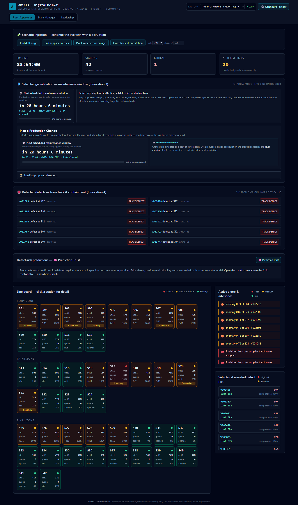

# TwinLine · Brownfield-aware assembly-line digital twin

A manufacturing engineer can trace a vehicle through 42 simulated stations, inspect a bottleneck and see which conclusions survive when sensors disappear. TwinLine models a vehicle assembly line with SimPy, aggregates its event stream into relational records and serves three React dashboards through FastAPI. All factory data in this repository is synthetic.



[Watch the dashboard walkthrough](docs/screenshots/walkthrough.mp4) · [Architecture and ETL diagrams](docs/architecture.md) · [Database diagram](docs/database_schema.md) · [Source inventory and API routes](docs/source_inventory.md)

## What runs

- Vehicle genealogy connects station visits, sensor aggregates, inspections and defects.
- Full, mixed and brownfield sensor configurations expose the effect of missing instrumentation on station observability.
- A Random Forest scores end-of-paint defect risk. An Isolation Forest scores unusual instrumented visits. The independent evaluation exposes substantial limitations.
- SQLite supports local experiments. PostgreSQL shares the SQLAlchemy model and Alembic migrations. Prometheus instrumentation and an optional Grafana profile expose operational metrics.

## Local quick start

Use Python 3.12 and Node 24. From the repository root, create an environment with `python -m venv .venv`. Activate it with `.venv/Scripts/Activate.ps1` in PowerShell or `source .venv/bin/activate` in Bash. Start with a fresh database.

```sh
python -m pip install -r backend/requirements.lock
python -m alembic -c backend/alembic.ini upgrade head
python scripts/generate_data.py --scenario mixed --vehicles 2000 --seed 42
python scripts/train_models.py
python -m pytest backend/tests -q
python -m uvicorn app.main:app --app-dir backend --host 127.0.0.1 --port 8000
```

In a second terminal, from this repository root:

```sh
cd frontend
npm ci
npm run build
npm run dev -- --host 127.0.0.1
```

Open **http://127.0.0.1:5173**. FastAPI serves interactive API documentation at **http://127.0.0.1:8000/docs**, OpenAPI at `/openapi.json`, probes at `/health` and `/ready`, and metrics at `/metrics`. The Vite proxy forwards `/api` requests to the backend. The generator refuses to populate an existing seeded line again. Use a new `--db` path for an independent experiment.

## Docker demo

Set `TWIN_POSTGRES_PASSWORD` to a newly generated, URL-safe local password in your shell or an untracked `.env` file. The checked-in [.env.example](.env.example) describes optional settings.

```sh
docker compose up --build --wait
```

The backend waits for PostgreSQL, applies Alembic migrations and seeds an empty demo. PostgreSQL data and model files live in named volumes. The frontend waits for backend readiness. Use `docker compose down` to stop services and preserve both volumes. Add `--profile ops` before `up` to include Prometheus and Grafana. [Docker verification status](docs/docker_verification.md)

## Reproduction results

| Experiment | Measured result |
|---|---|
| Full sensor, seed 42, 2,000 terminal outcomes | A full-sensor run reached 2,000 terminal vehicle outcomes (1,888 accepted, 112 scrapped), generating 1.39M simulated events and storing 568,883 rows in SQLite. |
| Three timed runs, Windows i5-1335U, local SQLite | 41.39 s median instrumented pipeline time. A fourth uninstrumented run took 38.34 s in the pipeline and 41.15 s for the CLI. |
| Mean observability, 42 stations per scenario | Full 0.934, mixed 0.669, brownfield 0.436. |
| Same 60-user local read profile, before and after | p95 fell from 8.7 s to 570 ms. The optimized run completed 8,502 requests with zero failures in a 60 s test. |
| Tests and schema | 29 pytest cases passed. SQLite and PostgreSQL 16.16 reflected 22 application tables. |
| Independent mixed-sensor ML run | At seed 137, the frozen classifier detected 2 of 38 defects and raised 155 false alerts. |

```sh
python scripts/reproduce_evidence.py --vehicles 2000 --seed 42 --full-runs 3 --mixed-runs 1 --output data/generated/my-experiment
python scripts/measure_load.py data/generated/my-experiment/mixed_1.db data/generated/load-check
```

Each run requires a new output directory and enough disk for several databases. The benchmark report distinguishes simulation clock, pipeline wall time and end-to-end CLI time. The load test uses a shared desktop and a read-heavy, single-worker SQLite workload. Neither supports a production service-level claim.

[Benchmark and per-table counts](docs/benchmark_report.md) · [Sensor experiment](docs/observability_report.md) · [Load test](docs/load_test_report.md) · [ML evaluation](docs/ml_evaluation_report.md) · [Test execution](docs/testing_report.md) · [Limitations](docs/limitations.md) · [Release changes](RELEASE_NOTES.md) · [Verified resume claims](CLAIM_VERIFICATION.md)

