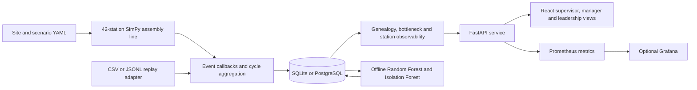
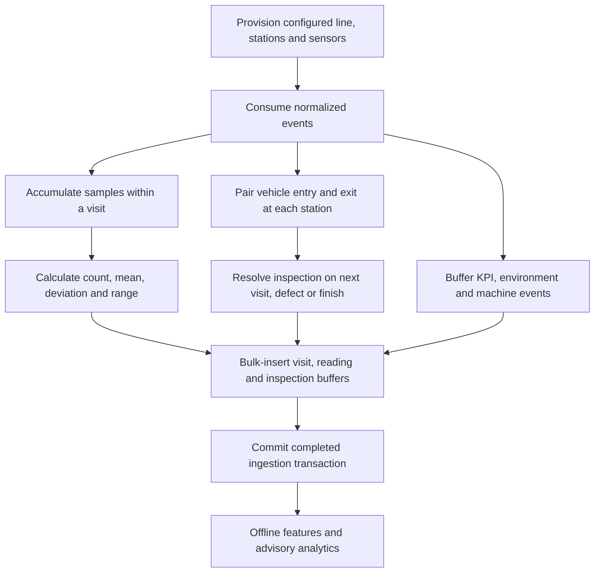

# TwinLine architecture

## Ingestion and data flow

Station topology and the synthetic event stream come from site YAML and scenario overrides. The pipeline records observations, preserves genealogy and commits the run. End-of-paint defect-risk features use historical measurements. A separate Isolation Forest identifies unusual instrumented visits. The browser communicates with FastAPI through the Vite development proxy. The PostgreSQL and SQLite backends share the same ORM. Dashboard snapshots on SQLite invalidate on database changes. The [ER diagram](database_schema.md) covers the physical schema.
