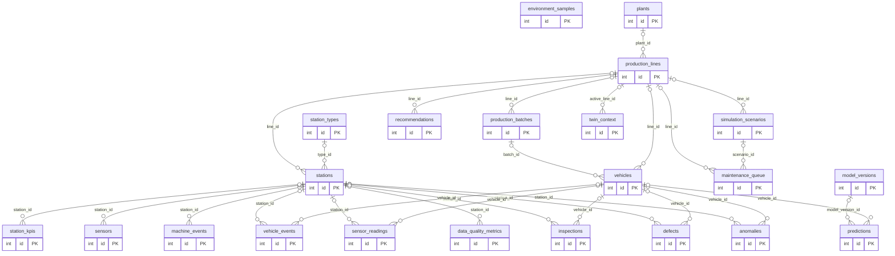

# Relational schema and migration verification

SQLAlchemy metadata, a freshly migrated SQLite database and PostgreSQL 16.16 each contained 22 application tables. Alembic adds one bookkeeping table. The initial revision creates 19 application tables; the next revision brings the migration history into alignment with the ORM. SQLite ran the populated-row upgrade/downgrade/re-upgrade regression. PostgreSQL ran empty-to-head, downgrade to revision 803153c85c70, re-upgrade, Alembic metadata comparison and a 60-finished-vehicle seed-7 simulation. These edges follow reflected foreign keys. Parent-side optionality is illustrative; inspect column nullability and constraints for exact semantics.

| Table | PK | Foreign keys | Indexes | Unique constraints | Check constraints |
|---|---|---|---|---|---|
| anomalies | id | 2 | 3 | 0 | 0 |
| data_quality_metrics | id | 1 | 1 | 0 | 0 |
| defects | id | 2 | 2 | 0 | 0 |
| environment_samples | id | 0 | 1 | 0 | 0 |
| inspections | id | 2 | 2 | 0 | 0 |
| machine_events | id | 1 | 1 | 0 | 0 |
| maintenance_queue | id | 2 | 2 | 0 | 0 |
| model_versions | id | 0 | 0 | 0 | 0 |
| plants | id | 0 | 0 | 1 | 0 |
| predictions | id | 2 | 2 | 0 | 0 |
| production_batches | id | 1 | 2 | 0 | 0 |
| production_lines | id | 1 | 1 | 0 | 0 |
| recommendations | id | 1 | 2 | 0 | 0 |
| sensor_readings | id | 2 | 3 | 0 | 0 |
| sensors | id | 1 | 1 | 0 | 0 |
| simulation_scenarios | id | 1 | 1 | 0 | 0 |
| station_kpis | id | 1 | 2 | 0 | 0 |
| station_types | id | 0 | 0 | 1 | 0 |
| stations | id | 2 | 4 | 0 | 0 |
| twin_context | id | 1 | 0 | 0 | 0 |
| vehicle_events | id | 2 | 2 | 0 | 0 |
| vehicles | id | 2 | 5 | 0 | 0 |



[SQLite reflection](evidence/sqlite-schema.json) · [PostgreSQL reflection](evidence/postgres-schema.json) · [PostgreSQL execution](evidence/postgres-final.log)

To repeat on Windows use an empty test directory and a local PostgreSQL bin directory. The script creates a password-protected loopback cluster, runs the checks and stops it. Point the ordinary Alembic commands only at the intended database. SQLAlchemy relationships are configured by the schema verifier. Alembic autogeneration and foreign-key checks complement tests but cannot prove every business invariant.
```powershell
./scripts/test_postgres.ps1 -Bin C:/PostgreSQL/bin -Scratch C:/Temp/twinline-new-cluster -Python (Get-Command python).Source
```
