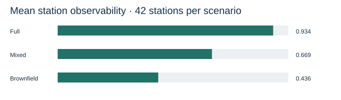

# Station observability

| Scenario | Coverage | Completeness | Fresh stations | Stale | No reading | Mean score |
|---|---|---|---|---|---|---|
| full | 1.0 | 1.0 | 20 | 22 | 0 | 0.934238 |
| mixed | 0.47619 | 1.0 | 18 | 11 | 13 | 0.66881 |
| brownfield | 0.083333 | 0.9999 | 8 | 6 | 28 | 0.436 |

Each row averages the same 42 station definitions after the anomaly pass. [Full](../configs/scenarios/full.yaml) and [brownfield](../configs/scenarios/brownfield.yaml) override the sensor profiles and injection settings of the [mixed site](../configs/automotive_line.yaml). [Per-station CSV](evidence/scenarios/stations.csv) contains registered sensors, visits, coverage, completeness, reading age, freshness class, anomaly density and score for every station.

Coverage is registered sensors / four reference sensor types. Completeness is the count of valid per-cycle aggregates divided by registered sensors × observed station visits, capped at one. An empty denominator yields one, so an uninstrumented station can receive 0.35 from completeness alone. Freshness uses the final KPI timestamp minus the latest reading timestamp, in simulation seconds. The freshness term is 1 for age 0–600, 0 for a missing reading and 0.4 otherwise. Anomaly density is flagged visits divided by observed visits (denominator at least one).

The station score is clip(0.45 × coverage + 0.35 × completeness + 0.20 × freshness term − 0.30 × anomaly density, 0, 1), rounded to three decimals. The overall score is the unweighted station mean. It measures instrumentation under a chosen policy. Per-prediction confidence uses model margin and feature completeness. Predictive accuracy requires comparing predictions with outcomes. None of the observability weights were calibrated against factory ground truth.

The prior corrected means rounded to 0.934 / 0.669 / 0.436. Earlier README figures had no traceable original raw run. Full-profile normalization now fits on the early segment, so small anomaly-density changes are possible. Equal seeds across scenarios do not produce paired vehicles because sensor configuration changes random draws. One seed per scenario limits generalization.
